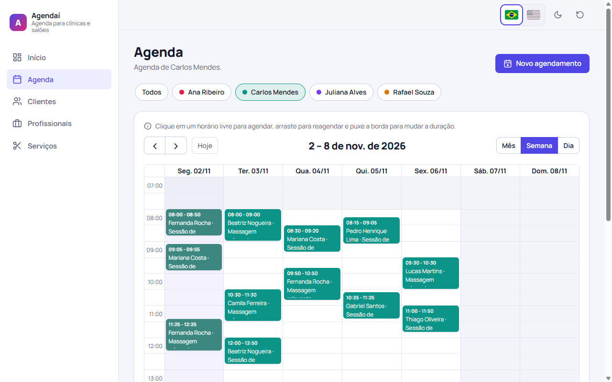

# Agendaí — scheduling for clinics and salons

[🇧🇷 Português](README.md) · 🇺🇸 English

A booking app for clinics and salons built with **Angular 20** and **FullCalendar**. You register professionals (with working hours per weekday), clients and services, then manage appointments on a month/week/day calendar with **drag to reschedule** and **resize to change the duration**. Every scheduling rule (no overlaps, inside working hours, never in the past) is a **custom Reactive Forms validator** — including an async validator and cross-field validators — and the same rules guard the calendar's drag & drop. The UI switches between Brazilian Portuguese and English at runtime with **Transloco**, with dates and currency formatted for the active language. Data lives in `localStorage`, with demo data generated around today's date.

**Demo:** https://brunoicosta.github.io/angular-appointment-scheduler/



## Highlights

- **Calendar:** month/week/day views, filter by professional (kept in the URL), shaded non-working hours, click a free slot to book, drag to reschedule, resize to change the duration. Invalid moves are reverted with an explanation.
- **Appointment form:** live async availability check (debounced, with a "checking availability…" state), working-hours and not-in-the-past checks, end-after-start cross-field rule, end time computed from the service duration.
- **Clients, professionals and services** CRUD pages with Brazilian CPF and phone validators, input masks and a weekly working-hours editor.
- **Dashboard** with upcoming appointments grouped by day, daily/weekly totals and expected revenue.
- Light/dark theme, responsive layout, accessible dialogs, toasts and empty states.

## Internationalization

- Initial language: saved choice (`localStorage`) > browser language (`pt*` → pt-BR, anything else → en) > pt-BR.
- The PT | EN switcher in the header updates Transloco, `<html lang>`, the formatting locale, the calendar locale and the page title, and saves the choice.
- Global strings live in `public/i18n/{pt-BR,en}.json`; each feature has a **lazy Transloco scope** in `public/i18n/<feature>/` registered with `provideTranslocoScope()` on its route, so translations download together with the feature chunk.
- User-entered content (service names, specialties, notes) is shown as typed.
- To add a language: add the JSON files, list it in `LANGUAGES` (`core/i18n/languages.ts`) and register its Angular locale data in `core/i18n/register-locales.ts`.

## Stack

Angular 20.3 (standalone, Signals, control flow, `@defer`), TypeScript 5.9, FullCalendar 6.1, Transloco 8.3, RxJS 7.8, Karma + Jasmine, ESLint + angular-eslint + Prettier. Custom SCSS design tokens, no component library.

## Architecture

- Every feature is lazy (`loadChildren` + `loadComponent`). FullCalendar (~270 kB) sits in its own `@defer` chunk, and the appointment dialog is deferred too.
- Pure scheduling rules (`core/scheduling/scheduling.rules.ts`) are shared by the form validators and the calendar drag/resize handlers.
- Signal-based `EntityStore<T>` per collection, persisted to `localStorage`; all components are `OnPush`.
- An injectable `CLOCK` token keeps time-dependent logic deterministic in tests.

## Running

```bash
npm install
npm start            # http://localhost:4200
npm run test:ci      # 114 unit tests in headless Chrome
npm run lint
npm run build
```

## Author

**Bruno Vinicius Isaac Costa** — https://github.com/BrunoICosta · [MIT License](LICENSE)
