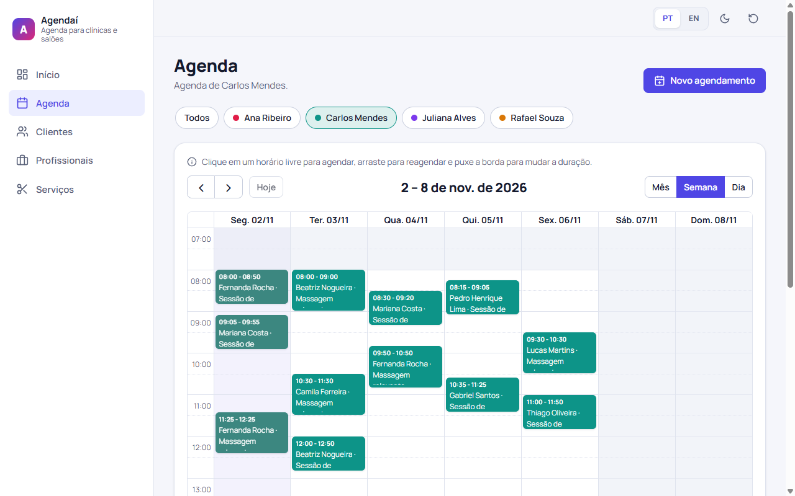
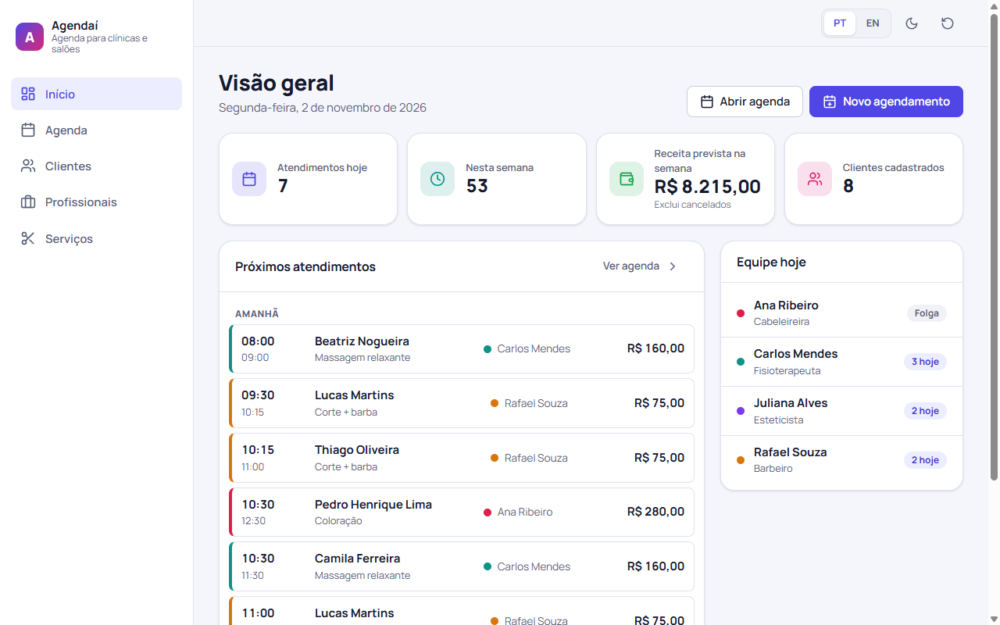

# Agendaí — agenda para clínicas e salões

Aplicação de agendamentos para clínicas e salões feita em **Angular 20** com **FullCalendar**. Permite cadastrar profissionais (com horário de atendimento por dia da semana), clientes e serviços, e organizar os atendimentos em uma agenda mensal, semanal ou diária com **arrastar para reagendar** e **redimensionar para mudar a duração**. Todas as regras de agenda (sem sobreposição, dentro do expediente, nunca no passado) são **validadores customizados de Reactive Forms** — incluindo um validador assíncrono e validadores cross-field — e as mesmas regras protegem o drag & drop do calendário. A interface é bilíngue (pt-BR/en) em tempo de execução com **Transloco**, com datas e moeda formatadas conforme o idioma. Os dados ficam no `localStorage`, com dados de demonstração gerados em torno da data atual.

**Demo:** https://brunoicosta.github.io/angular-appointment-scheduler/



<details>
<summary>Painel "Próximos atendimentos"</summary>



</details>

## Funcionalidades

- **Agenda (FullCalendar)** com visões de mês, semana e dia, filtro por profissional (refletido na URL, `?professional=`) e horário de expediente sombreado.
  - Clique ou arraste sobre um horário livre para abrir o formulário já preenchido.
  - Arraste um agendamento para reagendar e puxe a borda para alterar a duração. Se a mudança quebrar alguma regra, o evento volta para o lugar e uma mensagem explica o motivo.
  - Agendamentos concluídos/cancelados ficam visíveis como histórico, mas bloqueados.
- **Formulário de agendamento** com validação em tempo real:
  - sem sobreposição com outros agendamentos do profissional (**validador assíncrono**, com debounce e estado "verificando disponibilidade…");
  - dentro do horário de atendimento do profissional naquele dia da semana;
  - nunca no passado (editar um atendimento antigo sem mudar o horário continua permitido);
  - término depois do início (**cross-field**);
  - ao escolher o serviço, o término é calculado pela duração; mudar o início preserva a duração.
- **Clientes**: CRUD com busca (nome, e-mail, telefone ou CPF), **validador de CPF** (dígitos verificadores), CPF único, **máscara e validador de telefone** brasileiro (fixo e celular).
- **Profissionais**: CRUD com especialidade, cor na agenda e editor de horário semanal (validação por dia e "pelo menos um dia de atendimento").
- **Serviços**: catálogo com duração e preço; serviços em uso não podem ser excluídos.
- **Início**: próximos atendimentos agrupados por dia, totais do dia e da semana, receita prevista e a equipe do dia.
- **i18n**: alternância pt-BR/en sem recarregar a página — textos, título da aba, `<html lang>`, calendário, datas e moeda (`R$ 120,00` × `R$120.00`).
- Tema claro/escuro (respeita o sistema), layout responsivo (barra lateral no desktop, barra inferior no celular), estados vazios, toasts e diálogos acessíveis (`<dialog>` nativo, foco gerenciado, `aria-live`).
- Botão para restaurar os dados de demonstração.

## Stack

| Tecnologia | Versão |
| --- | --- |
| Angular (standalone, Signals, control flow, `@defer`) | 20.3 |
| TypeScript | 5.9 |
| FullCalendar (`@fullcalendar/angular`, daygrid, timegrid, interaction) | 6.1.20 |
| Transloco (`@jsverse/transloco`) | 8.3 |
| RxJS | 7.8 |
| Karma + Jasmine (ChromeHeadless) | 6.4 / 5.9 |
| ESLint + angular-eslint + Prettier | 9.39 / 20.7 / 3.8 |

SCSS próprio com design tokens em CSS custom properties — sem biblioteca de componentes.

## Arquitetura e decisões

```
src/app/
  app.component.*        raiz: <router-outlet>, diálogo de agendamento (@defer), confirmações e toasts
  app.config.ts          router (input binding, preloading), HttpClient, i18n, TitleStrategy traduzida
  app.routes.ts          apenas o shell + loadChildren de cada feature
  core/
    data/                seed de demonstração e restauração
    i18n/                Transloco (loader HTTP), LanguageService, locales, título traduzido
    layout/              shell, seletor de idioma, tema, restaurar dados
    models/              *.model.ts do domínio
    scheduling/          regras de agenda puras, AvailabilityService, AppointmentDialogService
    storage/             wrapper seguro do localStorage
    stores/              EntityStore<T> genérico com signals + stores por entidade
    theme/               ThemeService (claro/escuro)
  shared/
    forms/               validadores (CPF, telefone), máscara, FieldErrorComponent
    pipes/               localeDate / localeCurrency (seguem o idioma ativo)
    ui/                  ícones, modal, confirmação, toasts
    utils/               datas, texto, media query
  features/
    dashboard/           dashboard.routes.ts, pages/, components/, data-access/ (seletores puros)
    calendar/            calendar.routes.ts, pages/, components/ (FullCalendar, filtro), data-access/
    appointments/        components/appointment-dialog, data-access/ (validadores do formulário)
    clients/             clients.routes.ts, pages/, components/, data-access/ (CPF único)
    professionals/       professionals.routes.ts, pages/, components/, data-access/ (horários)
    services/            services.routes.ts, pages/, components/
```

- **Lazy loading em todas as features.** `app.routes.ts` só conhece o shell; cada feature tem seu `*.routes.ts` carregado via `loadChildren`, e cada página via `loadComponent`. O FullCalendar (~270 kB) fica num chunk próprio graças ao `@defer` no wrapper `SchedulerCalendarComponent`, e o diálogo de agendamento — aberto do calendário e do início — também é `@defer` (só é baixado na primeira vez em que é aberto). Saída do `ng build`:

  | Chunk lazy | Tamanho bruto | Transferência estimada |
  | --- | --- | --- |
  | `scheduler-calendar-component` (FullCalendar) | 270 kB | 67 kB |
  | `professionals-page-component` | 15,5 kB | 4,5 kB |
  | `appointment-dialog-component` | 14,5 kB | 4,3 kB |
  | `dashboard-page-component` | 12,2 kB | 3,7 kB |
  | `clients-page-component` | 12,1 kB | 3,8 kB |
  | `services-page-component` | 8,3 kB | 2,7 kB |
  | `calendar-page-component` | 7,8 kB | 2,8 kB |
  | `*-routes` (um por feature) | < 0,2 kB | — |

  Bundle inicial: ~408 kB brutos / ~119 kB transferidos (Angular, router, forms, Transloco e o shell).
- **Regras de agenda puras** (`core/scheduling/scheduling.rules.ts`): `findConflicts`, `checkWorkingHours`, `isInPast` e `validateSlot` não dependem de Angular. Os validadores do formulário e os handlers de drag/resize do calendário usam as mesmas funções, então as duas portas de entrada aplicam exatamente as mesmas regras.
- **Validador assíncrono "de verdade".** `AvailabilityService` tem a forma de uma chamada HTTP (retorna `Observable` com latência simulada). O validador faz debounce com `timer`, e o Angular cancela a execução anterior quando o valor muda — trocar por uma API real não muda nenhum consumidor.
- **Signals para estado.** Cada coleção é um `EntityStore<T>` com `signal` + `computed` (`all`, `byId`, `sorted`) persistido no `localStorage` a cada mutação; leitura corrompida volta para o seed e falha de escrita não derruba a aplicação. Componentes são todos `OnPush`; o diálogo espelha status/erros do formulário em signals (`form.events`) para refletir o estado `PENDING` da validação assíncrona.
- **i18n em tempo de execução com Transloco** em vez do i18n nativo do Angular (que gera um build por idioma). Datas e moeda usam `formatDate`/`formatCurrency` com o locale ativo por meio de pipes próprios; o FullCalendar recebe o locale correspondente; o título da aba é traduzido por uma `TitleStrategy`.
- **Tempo injetável.** `CLOCK` (`InjectionToken`) substitui `new Date()`, o que deixa validadores, seed e dashboard determinísticos nos testes.
- **Acessibilidade.** `<dialog>` nativo (foco preso, `Esc`, retorno do foco), labels em todos os campos, mensagens de erro ligadas por `aria-describedby`, regiões `aria-live`, `aria-pressed` nos filtros, link "pular para o conteúdo", foco visível e contraste AA nos dois temas. As regras `template/accessibility` do angular-eslint rodam no lint.

## Como rodar

Pré-requisitos: Node 22 e npm 10.

```bash
npm install
npm start              # http://localhost:4200
npm test               # Karma em modo watch
npm run test:ci        # execução única no ChromeHeadless
npm run lint
npm run build          # produção em dist/
npm run build:pages    # build com base-href do GitHub Pages
```

## Testes

102 testes unitários (Karma/Jasmine) cobrindo:

- validadores de CPF, telefone e CPF único, máscaras e utilitários de data;
- regras de agenda (sobreposição, expediente, passado, ordem de prioridade);
- validadores do formulário: cross-field, "não no passado", expediente e o **assíncrono** de sobreposição (com `fakeAsync`, incluindo a transição `PENDING → INVALID`);
- validadores de horário dos profissionais, `EntityStore` (seed, persistência, JSON corrompido, storage indisponível), `LanguageService` e seletores do dashboard;
- componentes: diálogo de agendamento (pré-preenchimento, cálculo do término, conflito, edição), dashboard, diretiva de máscara e `FieldErrorComponent`.

## Próximos passos

- Backend real (API + autenticação) substituindo o `localStorage` e o `AvailabilityService` simulado.
- Intervalos no expediente (almoço), feriados e bloqueios de agenda.
- Vincular serviços aos profissionais que os executam.
- Cadastro rápido de cliente dentro do formulário de agendamento.
- Lembretes por e-mail/WhatsApp e confirmação pelo cliente.
- Testes end-to-end (Playwright) para o drag & drop do calendário.

## Autor

**Bruno Vinicius Isaac Costa** — https://github.com/BrunoICosta

Licença [MIT](LICENSE).
